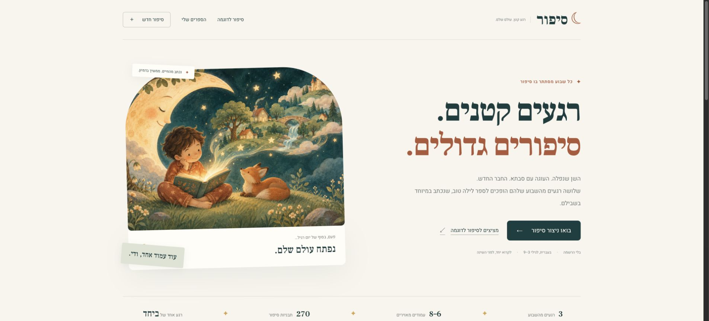
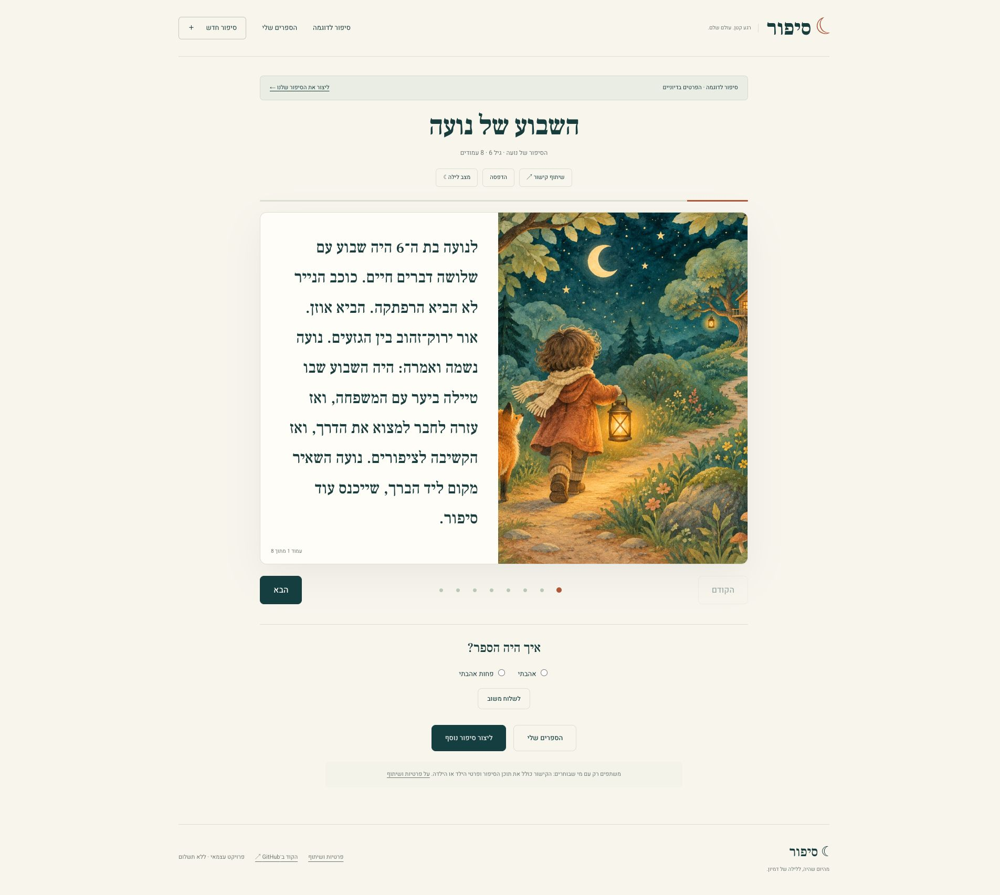
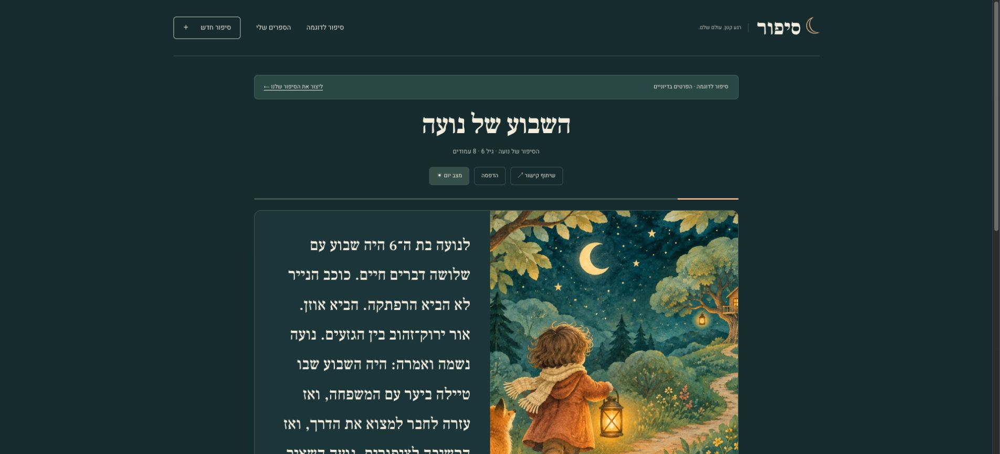

<div align="center">

# ☾ סיפור · Sipur

### Small moments. Big stories.

Turn three moments from a child's week into an illustrated Hebrew bedtime book.

**Hebrew & RTL · Ages 3–9 · Fact-aware story planning · No signup · No runtime API keys**

[**Open Sipur ↗**](https://jossefo.github.io/sipur/) · [What it does](#a-little-week-a-whole-world) · [See the app](#a-look-inside) · [Run locally](#run-locally) · [Privacy](#privacy-by-design-and-its-limits)

</div>



## A little week. A whole world.

A lost tooth. Baking with Grandma. Making a new friend. Sipur turns those small, real moments into a 6–8 page Hebrew picture book, with a gentle moral and a quiet ending for bedtime.

The experience is deliberately simple: enter a first name or nickname, an age, and three moments; then read together. The full public app runs on GitHub Pages: no account, payment flow, backend server, or language-model service is required.

- **Stories grounded in the week.** The Hebrew engine first extracts event facts and outcomes, chooses a shared question, then renders a connected bedtime narrative. Negation, disagreement, loss and unresolved problems are preserved. Ages 3–4 receive six shorter pages; ages 5–9 receive eight. Parents choose the Hebrew grammatical voice.
- **Original visual world.** Three bundled, AI-generated gouache-style illustrations and a procedural SVG scene library, served locally. No image hotlinks or external image generation at runtime.
- **A proper little reader.** Page controls, keyboard navigation, touch swipes on artwork, reading progress, night mode, and a print layout for the full book.
- **Your own shelf.** Books are saved in the current browser, with individual removal. The fictional demo never adds itself to your library. Library metadata helps avoid repeating a template across sessions on that device.
- **Made for Hebrew.** Right-to-left layouts, considered Hebrew typography, a responsive form, visible focus states, and reduced-motion support.

## A look inside

These are actual local app captures, using fictional sample data. Reader captures show the initial visual release; the current narrative engine is documented in the quality samples below.

<table>
<tr><th>Made for small screens</th><th>The illustrated reader</th></tr>
<tr>
<td width="30%" align="center"></td>
<td width="70%" valign="top"></td>
</tr>
</table>

<details>
<summary>Open the night-mode preview</summary>



</details>

### The artwork


| A lantern in the forest | A paper boat at dusk |
| --- | --- |
|  |  |

The artwork is bundled with the repository, so it is visible here and works without an image API. It is curated scene art, not a newly generated image for every book. [Artwork notes and generation prompts](docs/artwork.md).

## GitHub Pages: the full app, in your browser

The original Python story engine runs inside a **Web Worker with Pyodide 314.0.7**. This keeps the Hebrew grammar, event classification, template selection and SVG rendering in one shared implementation. The page stays responsive while the worker prepares the book.

The first creation or uncached shared-book visit downloads the Python/WebAssembly runtime from jsDelivr. Later requests can use the browser cache. Homepage artwork and the two sample books do not need to load that runtime.

**Names, ages and weekly moments stay in the browser.** Shared books live after `#` in the URL, so story payloads are not included in HTTP requests to GitHub Pages. Anyone with the full link can still read or decode the story. Ratings in the Pages version stay on that device too.

To preview the ready-built static site:

```bash
python3 -m http.server 8000
```

Open [localhost:8000](http://localhost:8000). To regenerate the static HTML and fictional demo files after changing the Flask templates:

```bash
pip install -r requirements.txt
python scripts/build_pages.py
```

Publish this branch's root in **Settings → Pages → Deploy from a branch**. The `.nojekyll` file keeps the files as authored. The `main` branch is preserved separately so this release does not update an existing Render deployment.

## Run locally

Requires Python 3.10 or newer.

```bash
python3 -m venv .venv
source .venv/bin/activate
pip install -r requirements.txt
python app.py
```

Open [localhost:3000](http://localhost:3000). Try `/demo` for a fictional example, `/create` for your own story, or `/library` for your saved books.

The legacy 270-entry catalog is retained for cover companions, visual variation and compatibility. It does **not** represent 270 independently written plots. The new planner controls the prose. To rebuild the catalog:

```bash
python scripts/build_templates.py
```

## How it works

```text
First name / nickname + age + 3 weekly moments
                      ↓
Hebrew facts + outcome analysis → narrative plan → checked prose
                      ↓
Concrete scenes → gentle turning point → bedtime ending
                      ↓
6–8 page book + local artwork + procedural SVG scenes
                      ↓
Browser library / self-contained share link / print
```

Built with **Python, Pyodide/WebAssembly, Web Workers, Flask, Jinja, vanilla JavaScript, CSS and SVG**. Stories are composed in Python, either in the browser worker or in the optional Flask server; the generative artwork was created during development and committed as optimized WebP files. There is no language-model or image-model call when someone creates a story.

Template selection avoids fingerprints already produced by the current engine session; the Pages adapter also passes saved library template IDs and fingerprints. This is not a global uniqueness guarantee across deployments or multiple workers.

## Privacy by design, and its limits

**A story link contains the story. Encoding is not encryption.** The name or nickname, age and generated pages are compressed into the URL. On GitHub Pages they are in the fragment after `#`; the optional Flask version uses the `/s/<token>` path. Anyone who receives the link can read or decode it. Use fictional examples or a first name/nickname and avoid sensitive details. Shared links cannot be revoked.

- No account database. The library lives in `localStorage` in that browser; clearing browser data removes the shelf.
- No story content is sent to an external image service. Google Fonts supplies typography and jsDelivr supplies the pinned Pyodide runtime. These providers receive ordinary file requests, not the form contents.
- On Pages, feedback is stored only in that browser and never sent to a server. In the optional Flask version, feedback accepts only a rating and a validated template ID. It discards story tokens and free-text notes, keeps at most 200 anonymous entries in memory, and has no public reading endpoint. Feedback is intentionally non-durable.
- The optional Flask server adds story-response headers: `Cache-Control: private, no-store`, `Referrer-Policy: no-referrer` and `X-Robots-Tag: noindex, nofollow`. These are best-effort precautions, not access controls.
- Request bodies and decoded story payloads are size-limited. Malformed story structures are rejected. A content security policy limits browser resource origins.
- The hosting provider may still log request URLs and IP addresses. Review hosting/log-retention settings before using real family information.

The in-app privacy page explains these choices in Hebrew. This is a personal project and a public source-code showcase, not an authenticated private family archive.

## Checks

```bash
pytest -q
node --check static/js/app.js
```

The 62-test suite includes 120 generated regression samples and covers story generation, weekly-event relevance, Hebrew theme classification, share-link round trips, malformed payloads, decompression limits, private headers, bundled images, anonymous feedback and request size limits.

## Deploy on Render

`render.yaml` describes a Python web service. Use:

```text
Build: pip install -r requirements.txt
Start: gunicorn -b 0.0.0.0:$PORT app:app
Health endpoint: /health
```

This is a server-rendered Flask application; it requires a Python web service. No paid external AI service or API key is required. Hosting availability and pricing depend on your provider.

---

<div align="center">מהיום שהיה, ללילה של דמיון. ☾<br />From the day that was, to a night of imagination.</div>

## Narrative quality

[Read six complete fictional sample books and the quality report](docs/story-quality.md). The planner gives each book one bedtime setting, three explicitly remembered events, a guiding question and a closing choice. It does not invent a real-world chronology between unrelated memories. Reconciliation is only used when supplied after a conflict; an unresolved problem is allowed to remain open.

This is a bounded, rule-based Hebrew storyteller, not a general language model. It currently uses a memory-book frame; unusual phrasing, sarcasm, complex relationships and nuanced negation can still exceed its rules. Automated checks protect structure and known regressions; they cannot certify literary quality or understand every sentence. A broader Hebrew parent/editor review and ongoing regression examples are still needed before claiming production-level narrative quality. No external model, account or API key is required.
